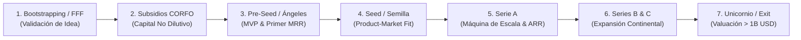

# Guía Completa Clase 7: Despliegue en Producción, Power Pitch para Capital & Demo Day

> **VibeCode Lab — Clase 7 (Final)**  
> **Tema Central:** Publicación en Vercel con dominio propio y SSL, estructuración de un Pitch Deck de alto impacto para inversores (CORFO, Ángeles y VCs) bajo el **Power Pitch Method®** y celebración del Demo Day en vivo.

---

## 1. MÓDULO TÉCNICO: Despliegue en Producción (Vercel + Dominio Propio + SSL)

El objetivo técnico de esta sesión es transformar el prototipo local en un **SaaS en producción accesible a nivel mundial** con estándar institucional.

### 1.1 Checklist de Variables de Entorno en Producción
Antes de desplegar en Vercel, es mandatorio asegurar que las llaves secretas de desarrollo no contaminen producción:
- **Supabase / Base de datos:** Cambiar credenciales locales o staging a las de producción (con Connection Pooling para Serverless).
- **Mercado Pago / Pasarela de Pagos:** Reemplazar las credenciales de prueba (`TEST-...`) por el Access Token definitivo de producción (`APP_USR-...`), y configurar el webhook/notificaciones apuntando al dominio oficial (`https://tu-saas.com/api/webhooks/mercadopago`).
- **PostHog / Analítica:** Configurar el host de ingestión y la llave de proyecto para filtrar el tráfico interno del equipo.
- **Cloudflare R2 / Storage:** Bucket de producción con CORS restringido exclusivamente a tu dominio HTTPS y sin costos de egreso de datos.

### 1.2 Configuración de Dominio Propio & DNS (NIC Chile / Cloudflare / Namecheap)
1. **En Vercel:** Ir a `Project Settings` > `Domains` > Agregar `tu-saas.com` y `www.tu-saas.com`.
2. **En el Proveedor DNS:**
   - **Registro A:** Host `@` apuntando a la IP de Vercel `76.76.21.21`.
   - **Registro CNAME:** Host `www` apuntando a `cname.vercel-dns.com`.
3. **SSL/TLS Automático:** Vercel emitirá y renovará automáticamente certificados Let's Encrypt mediante aprovisionamiento HTTP-01/DNS-01.

### 1.3 Smoke Test y Contingencia de Demo Day ("Plan B Anti-Caídas")
- **Cache Warming:** Visitar todas las rutas críticas (Landing, Auth, Onboarding, Paywall, Dashboard) para precargar los Serverless/Edge functions.
- **Backup de Video Local:** Grabar una interacción perfecta de pantalla de 45 segundos (en 1080p a 60fps) sin audio. Si el Wi-Fi o una API externa falla en el Demo Day, se reproduce el video diciendo: *"Aquí pueden ver el flujo exacto que procesa nuestra IA..."*.

---

## 2. EL POWER PITCH METHOD® ADAPTADO A INVERSORES

El **Power Pitch Method®** (creado por Héctor Sepúlveda Velásquez) toma la dramaturgia teatral para convertir una charla en una experiencia de alto impacto emocional e intelectual.

### Los Tres Pilares del Relato
1. **Deseable:** Genera un salto de valor tan evidente que el inversor o evaluador siente urgencia por ser parte de la solución.
2. **Irrefutable:** No se basa en opiniones ("creemos que nuestro producto es genial"), sino en evidencia fáctica, métricas reales y validación en terreno.
3. **Replicable:** El mensaje es tan conciso y nítido que un evaluador de CORFO o un analista de VC puede explicárselo a su comité de inversión en 30 segundos sin desfigurarlo.

```
       ┌───────────────┐
       │   DESEABLE    │ Salto de valor indiscutible
       └───────┬───────┘
               │
       ┌───────┴───────┐
       │  IRREFUTABLE  │ Respaldado por datos y tracción real
       └───────┬───────┘
               │
       ┌───────┴───────┐
       │  REPLICABLE   │ El comité lo puede repetir textualmente
       └───────────────┘
```

---

## 3. LAS 6 ESCENAS DEL POWER PITCH PARA CAPITAL (3 MINUTOS)

### Escena 1: El Dolor (The Pain) — Duración: ~30 segundos
- **Propósito:** Mostrar la herida sangrante del cliente ideal con cifras concretas (tiempo perdido, dinero desperdiciado, riesgo legal o estrés operativo).
- **Enfoque para CORFO:** Enfatizar la brecha de productividad y la oportunidad de modernización o ineficiencia de mercado nacional/regional.
- **Enfoque para VC / Ángeles:** Demostrar que es un dolor agudo en un mercado masivo (Hair-on-fire problem) por el cual el cliente ya está dispuesto a pagar.
- *Frase clave:* "Hoy en Latinoamérica, [X tipo de empresas] pierden [Y horas o Z dólares al mes] tratando de resolver manualmente..."

### Escena 2: El Analgésico (Current Workarounds) — Duración: ~25 segundos
- **Propósito:** Exponer las soluciones actuales que usa el mercado y por qué fracasan o son insuficientes (parches con hojas de cálculo, procesos manuales lentos o software legacy costoso).
- *Frase clave:* "El mercado intenta calmar esto contratando más personal o parchando con Excel y herramientas obsoletas que no conversan entre sí, generando cuellos de botella críticos."

### Escena 3: La Solución & Demo (The Solution) — Duración: ~40 segundos
- **Propósito:** Presentar el producto construido, su funcionamiento en 2 clics y la transformación radical (Antes vs. Después).
- **Acción:** Demostración en vivo o flujo visual rápido. Mostrar cómo la IA resuelve en segundos lo que antes tomaba días.
- *Frase clave:* "Desarrollamos [Nombre], el SaaS que automatiza [proceso clave] en segundos gracias a agentes de IA. Lo que antes tomaba 8 horas, ahora se resuelve con un clic."

### Escena 4: La Ambición (Market & Vision de Unicornio) — Duración: ~30 segundos
- **Propósito:** Abrir el horizonte de escala masiva. Demostrar el tamaño del mercado (TAM / SAM / SOM), la ventaja competitiva (Moat / foso defensivo) y la visión que proyecta a tu startup en la ruta hacia convertirse en un **unicornio** tecnológico en Latinoamérica.
- **Enfoque CORFO:** Escalabilidad internacional, exportación de servicios de alto valor agregado y tracción hacia el mercado hispanohablante/global.
- **Enfoque VC:** Oportunidad de escala exponencial (TAM > 1B USD), retornos de 10x-50x, efectos de red y barreras de entrada por datos propietarios y automatización con IA.
- *Frase clave:* "Partimos en Chile con un mercado inmediato de [X] millones, pero nuestra arquitectura serverless y almacenamiento en Cloudflare R2 nos permite capturar el mercado regional de [Y] millones sin costos marginales, en la ruta a construir el próximo unicornio tecnológico del sector."

### Escena 5: Implementación, Facilidad & Métricas de Tracción — Duración: ~35 segundos
- **Propósito:** Demostrar que el riesgo de ejecución es mínimo porque ya hay tracción comprobada y un equipo con capacidad de entrega.
- **Métricas:** Incorporar los números que mueven la aguja (usuarios registrados, MRR, tasa de conversión Freemium a Pago, CAC y retención).
- *Frase clave:* "En solo 4 semanas de validación lanzamos en producción bajo dominio propio en Vercel, pasarela de pago activa en Mercado Pago, captamos X usuarios activos y cerramos Y clientes de pago con un CAC de [Z] y un crecimiento MoM del W%."

### Escena 6: El Capital Requerido (The Ask), Inversión en el Unicornio & Cierre — Duración: ~25 segundos
- **Propósito:** Clarificar con total transparencia cuánto capital necesita la empresa, cómo se invertirá estratégicamente cada dólar para multiplicar el valor del negocio (tesis del unicornio) y rematar con un cierre asertivo de doble alternativa.
- **Estructura del discurso de inversión:**
  1. **El Monto Requerido (The Ask):** Declarar la cifra exacta y el instrumento legal (ej. *"Hoy estamos levantando una ronda pre-seed de 50.000 USD bajo un instrumento SAFE con Cap de 1.2M USD, con un 40% ya comprometido"* o postulación a 25M CLP de subsidio CORFO).
  2. **Plan de Inversión en el Unicornio (Uso de Fondos):**
     - **40% en Go-To-Market & Adquisición Agresiva:** Pauta segmentada, inbound marketing y prospección B2B para escalar de 15 a 150 clientes de pago.
     - **35% en I+D de Producto & Agentes de IA:** Infraestructura en Cloudflare R2, modelos propietarios y optimización de flujos de trabajo automatizados.
     - **25% en Talento & Runway:** 14 a 18 meses de pista financiera para asegurar la ejecución del equipo fundador.
  3. **Hito Desbloqueado:** La meta tangible que logrará la inyección de capital (ej. *"Multiplicar nuestro MRR de 1.200 USD a 12.000 USD y validar operaciones en México en 9 meses"*).
  4. **Cierre de Doble Alternativa:** Invitar a la acción ofreciendo dos salidas positivas que eliminen el rechazo pasivo.
- *Frase clave para Inversores:* "Para acelerar este crecimiento y construir el líder del sector, estamos levantando 50.000 USD en SAFE. Invertiremos el 40% en adquisición para llegar a 150 clientes B2B, 35% en tecnología e IA en Cloudflare R2 y 25% en runway para 14 meses, desbloqueando 12K USD de MRR. Para revisar nuestra data room y sumarse a la ronda: ¿prefieren que agendemos una llamada este jueves por la tarde o les resulta mejor el viernes por la mañana?"
- *Frase clave para Comités CORFO:* "Postulamos a los 25M CLP de CORFO Semilla con un plan de ejecución enfocado en 50% prospección comercial regional y 50% homologación técnica de nuestra IA. ¿Cuentan con espacio para validar una prueba técnica en su portafolio la próxima semana o coordinamos con el comité la entrega del dossier extendido?"

---

## 4. LO QUE REALMENTE MUEVE LA AGUJA: MÉTRICAS DE TRACCIÓN

Los evaluadores de CORFO y los inversores profesionales filtran el 95% de los proyectos por falta de tracción o métricas confusas.

| Métrica | Definición | ¿Por qué mueve la aguja? | Benchmark Esperado |
| :--- | :--- | :--- | :--- |
| **MRR / ARR** | Ingresos Recurrentes Mensuales / Anuales | Demuestra que los clientes pagan voluntariamente de forma continua. | Ingresos iniciales reales > 0 (validación temprana). |
| **MoM Growth** | Crecimiento mes a mes (% de ingresos o usuarios) | Valida la aceleración y la adopción del mercado. | 15% a 20% mensual en etapas tempranas. |
| **CAC** | Costo de Adquisición de Clientes | Cuánto cuesta conseguir 1 cliente de pago sumando marketing y ventas. | Debe ser decreciente a medida que el PLG madura. |
| **LTV** | Valor de Vida del Cliente | Cuánto dinero genera un cliente en promedio antes de abandonar. | Ratio **LTV / CAC > 3x**. |
| **Payback Period** | Tiempo de recuperación del CAC | Meses que toma recuperar la inversión hecha para traer al cliente. | **< 12 meses** (idealmente < 6 meses para SaaS SMB). |
| **Churn Rate** | Tasa de cancelación mensual | % de clientes o ingresos que se van al mes. | Churn mensual < 3-5% en B2B; retención neta > 100%. |
| **Activación / Aha! Moment** | % de usuarios que experimentan el valor principal en < 5 min | Señal de adopción intuitiva y Product-Led Growth efectivo. | > 40% de registros completan la acción clave. |
| **Burn Rate & Runway** | Quema de capital mensual y meses de vida restantes | Garantiza que el equipo no quebrará antes del siguiente hito. | 12 a 18 meses de runway planificado. |

---

## 5. LA ESCALERA DE FINANCIAMIENTO: DESDE SEMILLA HASTA UNICORNIO (Y SUS MATICES INTERMEDIOS)

Captar capital no es un evento aislado, sino un proceso escalonado donde cada ronda tiene un objetivo específico: **comprar tiempo (runway) para alcanzar el siguiente hito de des-riesgo**.

Ningún fondo invierte para que tu empresa sobreviva; invierten porque tu modelo demuestra capacidad de multiplicar el valor de la compañía en cada fase.



---

### Las 7 Fases del Viaje de Financiamiento

#### 1. Bootstrapping & FFF (Friends, Family & Fools)
* **Capital típico:** 0 USD a 25.000 USD (ahorros propios, préstamos familiares o ingresos de consultoría).
* **Objetivo:** Construir el primer prototipo funcional sin morir en el intento y validar que el problema realmente existe.
* **Métrica clave:** Entrevistas de dolor con más de 30 clientes potenciales, wireframes o MVP preliminar en Vercel.
* **Dilución:** 0% (si es con recursos propios) o máximo 5% a 10% si entra un familiar o amigo con capital de riesgo personal.

#### 2. Capital Público No Dilutivo (Subsidios CORFO en Chile / Grants Estatales)
* **Instrumentos:** CORFO Semilla Inicia (15M CLP), Semilla Expande (25M USD a 45M CLP), Innova Chile o fondos Startup Perú / Innpulsa Colombia.
* **Objetivo:** Financiar la investigación técnica, desarrollo de modelos de IA y homologación comercial inicial.
* **El gran matiz:** **0% de dilución (Equity-Free)**. El Estado no toma acciones de tu empresa, pero exige cofinanciamiento (15% a 25% aportado por el equipo), rendición rigurosa de gastos mes a mes y cumplimiento estricto de hitos técnicos.
* **Requisito para VibeCode:** Tener el MVP desplegado en producción, código propio y tracción preliminar de usuarios o cartas de interés (LOIs).

#### 3. Ronda Pre-Seed (Pre-Semilla / Ángeles & Aceleradoras)
* **Capital típico:** 50.000 USD a 250.000 USD.
* **Valoración referencial (Cap):** 1.0M USD a 2.5M USD.
* **Instrumento estándar:** **SAFE** (*Simple Agreement for Future Equity*) de Y Combinator con *Valuation Cap* y *Discount* (15% a 20%).
* **Inversionistas:** Redes de Ángeles Inversionistas (ej: Redes ACAFI, ChileGlobal Angels), aceleradoras (Platanus Ventures, Start-Up Chile, 500 Global, Y Combinator).
* **Métricas que exigen:** SaaS 100% en producción con dominio propio, pasarela de pago activa (Mercado Pago), primeros clientes recurrentes (500 USD a 3.000 USD de MRR) y retroalimentación semanal de usuarios activos.
* **Uso de fondos:** 40% Go-To-Market / 35% Infraestructura de IA en Cloudflare R2 / 25% Runway para 12 a 18 meses.
* **Dilución esperada:** 7% a 12% diferida al momento de la siguiente ronda de acciones.

#### 4. Ronda Seed (Semilla / Primer Capital Institucional)
* **Capital típico:** 500.000 USD a 2.500.000 USD.
* **Valoración referencial:** 4.0M USD a 10.0M USD.
* **Inversionistas:** Fondos de Venture Capital especializados en fase Semilla (ej: Kaszek Ventures, Canary, Magma Partners, DILA Capital, Dalus Capital).
* **Métricas que exigen:** **Product-Market Fit (PMF) demostrado**. MRR de 10.000 USD a 50.000 USD con crecimiento mes a mes (*MoM Growth*) sostenido superior al 15%-20%, Churn mensual bajo (< 3%) y economía unitaria con ratio LTV/CAC > 3x.
* **Objetivo:** Construir una máquina de ventas repetible y predecible, contratar ingenieros de IA senior y abrir el primer mercado internacional (típicamente México o Colombia desde Chile).
* **Dilución esperada:** 12% a 20%.

#### 5. Serie A (Validación del Modelo de Negocio & Escala Regional)
* **Capital típico:** 3.0M USD a 12.0M USD.
* **Valoración referencial:** 15.0M USD a 50.0M USD.
* **Inversionistas:** Fondos institucionales regionales y globales (Sequoia Capital, Andreessen Horowitz, Kaszek, Monashees, Valor Capital).
* **Métricas que exigen:** Ingresos Recurrentes Anuales (**ARR**) entre 1.0M USD y 3.0M USD. Métricas de retención neta de ingresos (**NRR**) > 110%, período de recuperación de CAC (*Payback*) menor a 12 meses y modelo de distribución probado en múltiples países.
* **Objetivo:** Dominar el mercado hispanohablante, consolidar un equipo corporativo de más de 40 personas y blindar el foso tecnológico (*Moat*) mediante datos y algoritmos propietarios.
* **Dilución esperada:** 15% a 25%.

#### 6. Series B y C (Hipercrecimiento y Consolidación de Mercado)
* **Capital típico:** 
  * **Serie B:** 15.0M USD a 40.0M USD (Valoración: 60M USD a 150M USD).
  * **Serie C:** 50.0M USD a 150.0M USD (Valoración: 200M USD a 600M USD).
* **Inversionistas:** Fondos de *Growth Equity*, Sovereign Wealth Funds y Private Equity global (SoftBank Latin America Fund, Tiger Global, Insight Partners).
* **Métricas que exigen:** ARR superior a 10M USD - 30M USD. Crecimiento anual sostenido (mínimo 2x a 3x año a año), expansión continental (desembarco en Brasil o EE.UU.) y potencial adquisición de competidores menores (*M&A*).
* **Objetivo:** Asegurar la posición de liderazgo indiscutible del sector y optimizar la rentabilidad operativa.

#### 7. Estatus Unicornio & Salida (Exit)
* **Capital / Valuación:** Ronda de Growth con una **valoración privada superior a los 1.000 millones de USD** (1B USD).
* **Ejemplos de la región:** NotCo, Cornershop (adquirida por Uber), Betterfly, Buk, dLocal, Nubank, Kavak.
* **Hitos reales:** Un unicornio no es una medalla decorativa; exige un mercado total gigantesco (**TAM > 5B USD+ USD**), ingresos anuales superiores a 100M USD y un impacto estructural en la productividad de una industria global.
* **Mecanismos de Salida (*Exit*):**
  1. **IPO (*Initial Public Offering*):** Salida a bolsa pública de valores (NASDAQ, NYSE).
  2. **M&A (*Mergers & Acquisitions*):** Venta estratégica de la compañía a un gigante tecnológico global (Google, Microsoft, Salesforce, Uber).

---

### Tabla Comparativa de Rondas de Inversión

| Fase | Capital Típico | Valoración Referencial | Instrumento Legal | Foco Principal | Métrica Reina |
| :--- | :---: | :---: | :---: | :--- | :--- |
| **Bootstrapping** | 0 USD - 25K USD | N/A | Fondos propios / FFF | Prototipo y dolor de mercado | 30+ entrevistas de usuarios |
| **CORFO / Grants** | 15M USD - 45M CLP | Sin dilución | Subsidio no reembolsable | I+D e IA aplicada | MVP en producción y facturación |
| **Pre-Seed** | 50K USD - 250K USD | 1M USD - 2.5M USD | SAFE (Cap / Discount) | Tracción inicial y retención | 1K USD - 5K USD MRR |
| **Seed** | 500K USD - 2.5M USD | 4M USD - 10M USD | SAFE o Acciones Preferentes | Product-Market Fit (PMF) | 15K USD - 50K USD MRR / LTV/CAC > 3x |
| **Serie A** | 3M USD - 12M USD | 15M USD - 50M USD | Rondas de Equity formal | Máquina de ventas regional | 1M USD - 3M USD ARR / NRR > 110% |
| **Series B / C** | 15M USD - 150M USD | 60M USD - 500M USD+ | Equity Institucional | Dominio de mercado e hiper-escala | 10M USD+ ARR / Rentabilidad unitaria |
| **Unicornio** | 100M USD+ | **> 1.000M USD** | Growth Equity / Pre-IPO | Líder global indiscutido | 50M USD - 100M USD+ ARR / TAM > 5B USD |

---

### 💡 Los Matices Intermedios que Todo Founder Debe Entender

1. **Dilución Acumulada vs. Control de la Empresa:**  
   En cada ronda de capital privado cedes entre un 10% y un 25% de la compañía. Si levantas Pre-Seed, Seed y Serie A sin disciplina, los fundadores pueden llegar a la Serie B con menos del 40% del capital accionario, perdiendo el control del directorio. Por eso el capital público no dilutivo (CORFO) al inicio es tan valioso.

2. **El "Valle de la Muerte" (Entre Pre-Seed y Seed):**  
   Ocurre cuando el dinero de la ronda ángel o subsidio se acaba (Runway en cero) pero el producto aún no alcanza la tracción de MRR suficiente para convencer a un fondo de Serie Semilla. Para sortearlo: mantén un *Burn Rate* austero, cobra desde el día 1 mediante Mercado Pago y automatiza tu infraestructura.

3. **Ronda Puente (*Bridge Round*):**  
   Una pequeña inyección de capital intermedio (típicamente 50K USD a 200K USD mediante un SAFE con descuento) otorgada por inversionistas actuales para extender el Runway por 4 a 6 meses hasta cerrar una ronda mayor o alcanzar un hito comercial crítico.

4. **El Peligro del *Down Round*:**  
   Levantar a una valoración inflada en etapas tempranas (ej: 10M USD de Cap cuando apenas facturas 500 USD) es una trampa. Si en la siguiente ronda tus métricas no justifican esa cifra, tendrás que levantar a una valoración menor (*Down Round*), lo que destruye la moral del equipo y activa cláusulas anti-dilución muy agresivas de los primeros inversionistas.

5. **La Regla del 40% en SaaS:**  
   Métrica estándar que siguen los VCs en etapas maduras: la suma de tu tasa de crecimiento anual (%) y tu margen de beneficio operativo (%) debe ser **superior al 40%**. Si creces al 80% anual, puedes permitirte operar con un margen de -40% (quema controlada). Si creces al 20%, debes ser rentable al 20%.

---

## 6. CÓMO ADAPTAR EL PITCH SEGÚN EL INTERLOCUTOR

### Frente a Evaluadores CORFO (Semilla Inicia / Expande / Crea y Valida)
- **Qué buscan:** Novedad respecto a la oferta existente en Chile, modelo de negocios con potencial de escalabilidad internacional, solvencia técnica del equipo y coherencia presupuestaria.
- **Gatillo de éxito:** Mostrar que el desarrollo no es un "sitio web más", sino un activo tecnológico propio potenciado por inteligencia artificial aplicada, con validación comercial preliminar (LOIs, ventas piloto, usuarios activos).

### Frente a Inversionistas Ángeles (Clubes de Ángeles, Redes ACAFI)
- **Qué buscan:** Confianza ciega en el equipo fundador, velocidad extrema de iteración, capacidad de venta y términos simples de inversión (SAFE con Cap y Discount).
- **Gatillo de éxito:** Demostrar que en 7 semanas pasaron de cero a un SaaS funcionando con pasarela de pagos y clientes reales.

### Frente a Venture Capitals (Pre-Seed / Seed y la Tesis del Unicornio)
- **Qué buscan:** Mercados billonarios (TAM > 1B USD), unit economics saludables, ventajas defensivas de datos y un equipo con la visión y capacidad de construir un **unicornio** (startup valorada en más de 1.000 millones de USD) multiplicando el capital inyectado por 10x-50x.
- **Cómo defender el capital y la inversión en el unicornio durante el discurso:**
  1. **El Monto Requerido (The Ask):** Sé directo desde el primer segundo. Nunca digas "buscamos apoyo"; di: *"Estamos levantando una ronda Pre-Seed de 50.000 USD mediante un instrumento SAFE con Cap de 1.2M USD"* (o el monto exacto acordado por tu squad).
  2. **La Inversión Estratégica en el Unicornio (Plan de Uso de Fondos):**
     - **40% en Go-To-Market & Adquisición Agresiva:** Pauta digital en canales de alta conversión, automatizaciones de prospección B2B outbound y eventos de industria para escalar rápidamente de 15 a 150 clientes de pago.
     - **35% en I+D, Producto y Modelos de IA Propietarios:** Arquitectura serverless en Vercel, infraestructura de almacenamiento en Cloudflare R2 y entrenamiento de agentes multimodales que eleven el foso defensivo (Moat).
     - **25% en Talento Clave & Runway:** Asegurar entre 14 y 18 meses de caja operativa ininterrumpida para fundadores e ingenieros dedicados 100% al crecimiento.
  3. **El Hito Desbloqueador:** Los VCs no invierten en supervivencia, invierten en hitos que multiplican el valor de la empresa. Tu discurso debe cerrar demostrando que este capital te llevará a cruzar la barrera de los **12.000 USD a 15.000 USD de MRR** y validar la expansión comercial en México y Colombia en 9 meses.

---

## 7. QUIZ FINAL DE CIERRE & CERTIFICADO DE PARTICIPACIÓN

Para formalizar la finalización del programa y consolidar los aprendizajes, cada estudiante debe completar el **Quiz Final de Cierre** alojado en la plataforma oficial (`https://www.javiermujica.com/quiz`).

### ¿Por qué es el entregable de cierre mandatorio?
1. **Entrega Oficial del Activo:** En el paso 1 del quiz se indexa el nombre formal del proyecto, squad y la **URL del proyecto** (en producción o enlace de prototipo/staging si aún están afinando detalles).
2. **Cierre de Ciclo Reflexivo:** Evalúa los cuellos de botella superados, la transformación desde el día 1 y la experiencia construyendo con IA.
3. **Emisión Inmediata de Certificado Preliminar:** Al completar y enviar el formulario, el backend genera y descarga en segundos tu **Certificado Preliminar de Participación en PDF** tanto en pantalla como a tu correo electrónico, cerrando formalmente tu ciclo académico.
4. **Retroalimentación y NPS:** Permite rankear la experiencia y dejar testimonios para la siguiente cohorte.

### 🎓 Certificado Preliminar vs. Certificación Oficial con QR, ID Único y Link a tu MVP
Para asegurar rigor técnico y dar flexibilidad a los squads que aún están terminando sus desarrollos:
- **Paso 1 — Certificado Preliminar (Inmediato):** Todos los alumnos deben contestar el quiz en `https://www.javiermujica.com/quiz` al finalizar la clase. Obtendrán su Certificado Preliminar de Participación al instante generado por el sistema.
- **Paso 2 — Envío y Revisión del Prototipo Funcional:** Cuando tu squad tenga su prototipo 100% funcional (desplegado en producción con dominio propio, base de datos y pasarela de pago activa), envían el enlace final a Javier.
- **Paso 3 — Validación Oficial con QR e ID Único:** Javier audita y valida el prototipo funcional en producción. La validación oficial te otorga un **código QR y un ID único** (ej: `VBC-2026-XXX`) que enlaza a una **página pública de confirmación** en `javiermujica.com`. En esta página se visualiza tu certificado oficial acreditado y el **link directo a tu MVP en producción**, permitiendo que evaluadores de fondos, inversionistas y clientes verifiquen tu software funcionando en vivo.

---

## 8. GLOSARIO GENERAL DE ACRÓNIMOS Y SIGLAS (FOUNDER CHEATSHEET)

Para que ningún término técnico o financiero sea una barrera para ti o tu equipo:

### Conceptos de Negocio, Tracción y Finanzas
- **SaaS (*Software as a Service*):** Modelo donde el software vive en servidores en la nube y los clientes pagan por su uso mediante una suscripción mensual o anual recurrente.
- **MRR (*Monthly Recurring Revenue*):** Ingresos recurrentes que tu empresa factura mes a mes. Es la métrica reina para medir la predictibilidad de tu negocio.
- **ARR (*Annual Recurring Revenue*):** Ingresos recurrentes proyectados a 12 meses (MRR \times 12).
- **MoM Growth (*Month-over-Month*):** Ritmo de crecimiento porcentual entre un mes y el anterior (ingresos o usuarios activos).
- **CAC (*Customer Acquisition Cost*):** Cuánto te cuesta en marketing y ventas adquirir un cliente nuevo que pague.
- **LTV (*Lifetime Value*):** Valor total de vida del cliente; es la ganancia neta promedio que aporta un cliente antes de abandonar tu servicio.
- **LTV / CAC:** Ratio de eficiencia comercial. Si es menor a 3x, estás quemando demasiado dinero para captar usuarios. Lo óptimo es situarse entre 3x y 5x.
- **Payback Period:** Tiempo (en meses) que tarda un cliente en generar suficiente margen para cubrir el costo de haberlo adquirido (su CAC).
- **Churn Rate:** Tasa de cancelación o porcentaje de clientes/ingresos que se dan de baja cada mes.
- **NRR (*Net Revenue Retention*):** Retención neta de ingresos. Mide si tus clientes actuales gastan más contigo a lo largo del tiempo (upgrades, planes superiores) descontando las cancelaciones. Un NRR > 100% significa que tu SaaS crece incluso sin traer clientes nuevos.
- **Burn Rate:** Cantidad de dinero neto que tu startup gasta o "quema" cada mes para operar.
- **Runway:** Cantidad de meses de vida que le quedan a tu empresa con el dinero en caja antes de quedarse en cero (Caja / Burn Rate).

### Conceptos de Mercado y Levantamiento de Capital
- **TAM (*Total Addressable Market*):** Mercado total direccionable; el volumen máximo de facturación si capturaras al 100% de los clientes posibles.
- **SAM (*Serviceable Addressable Market*):** La porción del TAM a la que tu producto y tecnología pueden servir hoy en día.
- **SOM (*Serviceable Obtainable Market*):** El segmento realista de mercado que tu equipo se propone capturar en los próximos 12 a 24 meses.
- **Moat (Foso Defensivo):** Ventaja competitiva única y defendible (algoritmos propios, datos privados, efectos de red o regulaciones) que impide que competidores o gigantes tecnológicos te dejen obsoleto.
- **CORFO:** Corporación de Fomento de la Producción. Agencia del Estado de Chile que financia proyectos de innovación y startups con subsidios no reembolsables (sin pedir acciones a cambio).
- **Ángel Inversionista:** Profesional o empresario experimentado que invierte su capital personal y contactos en fases muy tempranas a cambio de participación accionaria.
- **Venture Capital (VC):** Fondos profesionales de inversión que buscan empresas de crecimiento exponencial (10x a 50x) para inyectar rondas de capital institucional.
- **SAFE (*Simple Agreement for Future Equity*):** Instrumento legal creado por la aceleradora Y Combinator que permite recibir inversión de forma rápida y sencilla sin fijar una valoración rígida inmediata de la empresa.
- **Cap:** Techo o límite máximo de valoración fijado en un contrato SAFE para proteger al inversionista temprano si la empresa se dispara en valor.
- **Discount:** Descuento porcentual (típicamente 15% a 25%) que recibe el inversor temprano en el precio por acción al momento de la siguiente ronda de inversión formal.
- **LOI (*Letter of Intent*):** Carta de intención comercial formal donde un cliente declara por escrito su compromiso de adquirir tu solución.
- **Unicornio (*Unicorn Startup*):** Empresa privada de base tecnológica que alcanza una valoración de mercado superior a los **1.000 millones de dólares (USD)** antes de salir a bolsa, impulsada por un modelo de negocio hiper-escalable, barreras de entrada por IA y alcance multinacional.
- **The Ask (Capital Requerido):** El monto exacto de dinero que una startup solicita a los inversionistas en una ronda específica, explicitando el instrumento de entrada (ej: SAFE con Cap/Discount).
- **Use of Funds (Plan de Uso de Fondos):** Desglose presupuestario porcentual que explica con transparencia cómo se invertirá el capital levantado para multiplicar el valor y los ingresos del negocio (típicamente 40% GTM / 35% Producto / 25% Runway).

### Conceptos Técnicos y de Infraestructura
- **Vercel:** Plataforma cloud global optimizada para desplegar, compilar y servir aplicaciones web modernas con arquitectura Serverless y Edge sin administrar servidores manualmente.
- **DNS (*Domain Name System*):** Sistema mundial que traduce nombres legibles (`tu-saas.com`) a direcciones IP numéricas (`76.76.21.21`).
- **SSL / TLS (*Secure Sockets Layer*):** Certificado criptográfico que asegura que la conexión entre el navegador del usuario y tu app sea 100% privada y cifrada (candado HTTPS).
- **CORS (*Cross-Origin Resource Sharing*):** Mecanismo de seguridad de los navegadores que bloquea el acceso a recursos (archivos, APIs) solicitados desde un dominio distinto al autorizado.
- **Cloudflare R2:** Almacenamiento de archivos en la nube compatible con el protocolo S3 de AWS, diseñado para almacenar imágenes, audios y documentos sin cobrar costos abusivos por egreso de datos.
- **Webhook:** Mecanismo en tiempo real donde un servidor notifica automáticamente a otro que ha ocurrido un evento relevante (ej. Mercado Pago confirmando un pago exitoso a tu backend).
- **Connection Pooling:** Manejador de conexiones simultáneas para bases de datos (como Supabase Postgres) que evita que miles de funciones serverless colapsen el motor de datos.
- **MVP (*Minimum Viable Product*):** Producto Mínimo Viable; la versión inicial funcional de tu SaaS que resuelve el problema central y permite recibir retroalimentación y pagos reales.
- **NPS (*Net Promoter Score*):** Indicador estándar de satisfacción de -100 a +100 basado en qué tan dispuestos están tus usuarios a recomendar tu producto a otros.
